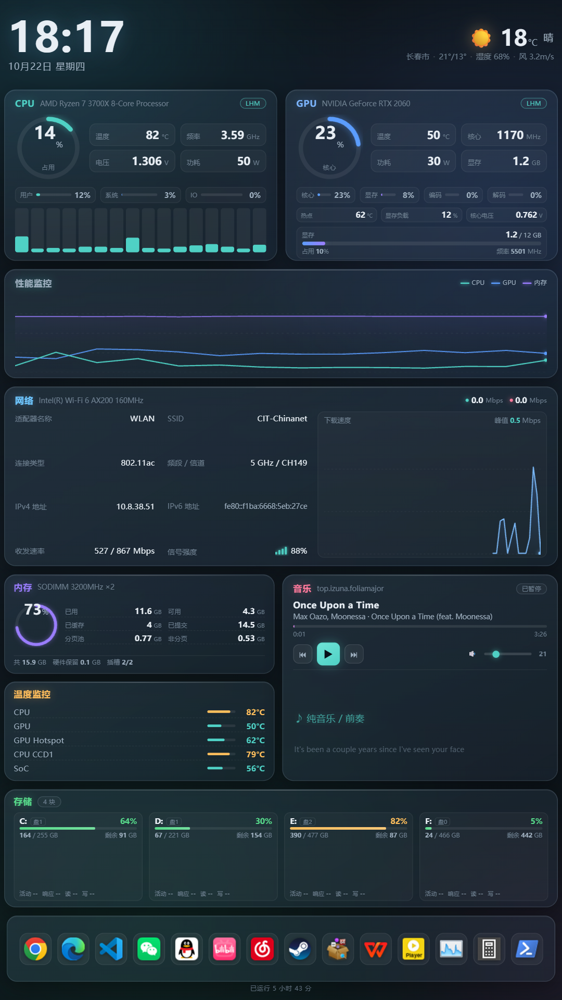
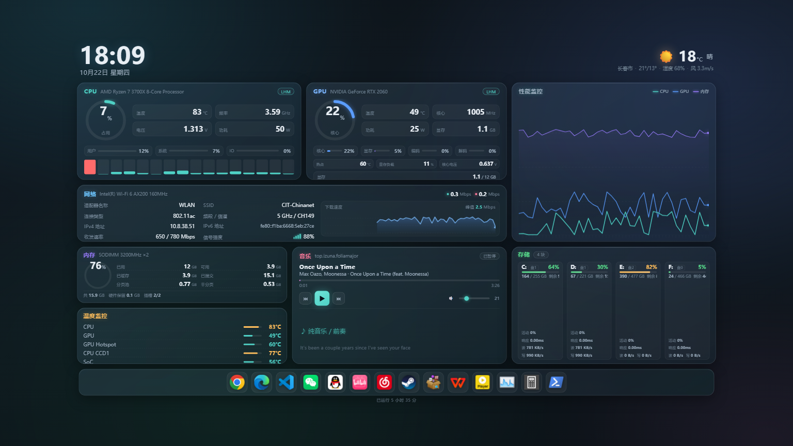

# 副屏监控 · GlancePad

> 一块闲置的竖屏，变成桌面上最顺眼的硬件仪表盘。

**GlancePad** 是一款 Windows 桌面监控面板，专门为**竖屏副屏**设计（1080×1920 / 设计稿 864×1536）。
暗色毛玻璃风格，CPU / GPU / 内存 / 存储 / 网络 / 天气 / 音乐播放器 / 快捷启动 Dock 一屏看全，
自动适配任意分辨率，横屏则自动切三列布局。

<p align="center">
  
  
</p>

<p align="center">
  <sub>左：1080×1920 竖屏　|　右：1536×864 横屏（同一份代码，自动切布局）</sub>
</p>

---

## 这个工具能做什么

它把一个网页变成一块**常驻副屏的系统仪表盘**：

| 模块 | 显示内容 |
|---|---|
| **顶部** | 时钟、日期、天气（城市 / 温度 / 天气现象 / 最高最低 / 湿度 / 风速） |
| **CPU** | 占用率圆环、温度、频率、电压、功耗、用户/系统/IO 占比、16 核逐核占用 |
| **GPU** | 占用率圆环、温度、频率、功耗、显存占用条、热点温度、显存负载、核心电压、核心/显存/编码/解码利用率 |
| **性能监控** | CPU / GPU / 内存 三条 60 点滚动折线 |
| **网络** | SSID、适配器、连接类型、频段信道、IPv4/IPv6、收发速率、信号强度、**下载速度折线** |
| **内存** | 已用/可用/已缓存/已提交/分页池/非分页 + 内存条规格（型号/频率/插槽） |
| **温度监控** | CPU、GPU、GPU 热点、CPU CCD1、SoC |
| **存储** | 每块盘一张卡：占用条、已用/总量、剩余、**活动时间、平均响应、读写速度**、物理盘号 |
| **音乐播放器** | 播放/暂停/上一首/下一首、系统音量、歌名歌手、**三行滚动歌词**、待机频谱 |
| **快捷启动 Dock** | 点击即启动应用，悬停显示名称气泡，图标/名称/路径/顺序**全部可自定义** |

配套还带一个**托盘程序兼设置程序**，解决"全屏 kiosk 退不出来"的经典问题，
并且可以在图形界面里直接改 Dock 和天气城市，不用手动编辑 JSON。

---

## 快速开始

### 环境要求

- **Windows 10 / 11**（用了 `winsdk` / `pycaw` / `winreg` / `ctypes.wintypes`，跨平台跑不了）
- **Python 3.9+**（推荐 3.11，安装时请勾选 *Add Python to PATH*）
- **Google Chrome**（用作 kiosk 全屏外壳）

### 三步跑起来

```powershell
# 1. 装 Python 依赖
pip install -r requirements.txt

# 2. 部署传感器采集桥（自动下载 LibreHardwareMonitor 并编译，可选但强烈建议）
powershell -ExecutionPolicy Bypass -File .\tools\setup_lhm.ps1

# 3. 启动
powershell -ExecutionPolicy Bypass -File .\start_monitor.ps1
```

脚本会依次：启动 LHM 采集桥 → 启动 Flask 服务（8770）→ 在副屏打开 kiosk 全屏窗口 →
启动置顶守护 → 驻留托盘图标。

> **想先看看效果？** 只起服务：`.\start_monitor.ps1 -NoBrowser`，
> 然后浏览器打开 <http://127.0.0.1:8770/>。

### 常用命令

```powershell
.\start_monitor.ps1              # 启动全部
.\start_monitor.ps1 -Status      # 看各组件运行状态
.\start_monitor.ps1 -Stop        # 停掉服务/窗口/守护（托盘保留）
.\start_monitor.ps1 -Quit        # 连托盘程序一起退出
.\start_monitor.ps1 -NoBrowser   # 只起后端，不开窗口
.\start_monitor.ps1 -Screen 2    # 指定用第几块屏（0=自动选非主屏）
.\start_monitor.ps1 -NoTopMost   # 不强制置顶
.\start_monitor.ps1 -NoTray      # 不起托盘
```

### 怎么退出全屏

kiosk 全屏没有关闭按钮，这是故意的（避免误触）。退出方式：

- **右键右下角托盘图标 →「停止监控」**（推荐）
- 或命令行 `.\start_monitor.ps1 -Quit`
- 或 `Alt + F4`

---

## 自定义

### 改快捷启动 Dock

**右键托盘图标 →「设置…」**，在「快捷启动 Dock」页里：

- 添加应用：填名称、选程序路径（有文件浏览器）、选图标 PNG、可填启动参数
- 编辑 / 删除 / 上移 / 下移
- 保存后监控页面 **20 秒内自动刷新**，不用重启

也可以直接改 `settings.json`（首次运行自动生成）：

```json
{
  "city": "杭州市",
  "latitude": 30.2741,
  "longitude": 120.1551,
  "weather": true,
  "apps": [
    { "name": "Chrome", "path": "C:\\Program Files\\Google\\Chrome\\Application\\chrome.exe", "icon": "chrome.png", "args": "" }
  ]
}
```

> `icon` 只写文件名时会去 `static/icons/` 找；也可以填 `/static/icons/xxx.png` 或完整的 http(s) 地址。
> 路径没在 `settings.json` 里登记的程序**无法被 Dock 启动**（`/api/launch` 会返回 403），这是刻意的安全限制。

### 改天气城市

同一设置窗口的「天气与位置」页，填城市名 + 经纬度即可（城市名只是显示用，天气按经纬度查）。
天气数据来自 [open-meteo.com](https://open-meteo.com/)，**免费、无需 API key**。

---

## 数据从哪来

三层数据源，按优先级自动降级，**缺哪层都能跑**，只是对应字段显示 `--`：

| 优先级 | 来源 | 能拿到什么 | 需要什么 |
|---|---|---|---|
| 1 | **AIDA64** | 几乎全部传感器 | AIDA64 里勾选「允许共享内存」或「允许将监测数据写入注册表」 |
| 2 | **LibreHardwareMonitor** | CPU 温度/功耗/电压/频率、GPU 温度/热点/显存负载/核心电压、内存 | **PawnIO** 内核驱动 + `tools/setup_lhm.ps1` 部署桥接 |
| 3 | **psutil / nvidia-smi** | CPU 占用、内存、磁盘、网络、GPU 基础项 | 无，装好 Python 包就能用 |

页面右上角的徽章（`AIDA64` / `LHM` / `psutil`）会告诉你当前实际生效的是哪一层。

### 关于 PawnIO

LibreHardwareMonitor v0.9.6 起改用 [PawnIO](https://github.com/namazso/PawnIO.Setup) 作为 ring0 后端。
**没装它时**：CPU 温度 / 功耗 / 频率、主板温度、风扇转速 全部读不到（显示 `--`），
GPU / 内存 / 网络不受影响。

安装：下载 [PawnIO_setup.exe](https://github.com/namazso/PawnIO.Setup/releases/latest) → 右键「以管理员身份运行」→
装完用 `Get-Service PawnIO` 确认状态是 `Running`。

> 小坑：PawnIO 安装器界面是自绘的，**弹着窗口不代表没装成功**，以服务状态为准。

### 为什么 AIDA64 要手动开

AIDA64 的界面是 Delphi VCL 全自绘，没有任何可靠的 UI 自动化入口（无 Win32 菜单、无 UIAutomation 按钮、
不接受投递的鼠标消息）。本项目**不尝试自动点它**，请手动在 AIDA64 里开：

`文件 → 设置 → 外部应用程序 → 勾选「允许共享内存」或「允许将监测数据写入注册表」`

---

## 目录结构

```
glancepad/
├─ app.py                  Flask 服务（8770）
│                            /  /api/snapshot  /api/stream(SSE)  /api/sources
│                            /api/media  /api/media/control  /api/media/volume
│                            /api/apps  /api/apps/version  /api/launch  /api/settings
├─ launcher.pyw            托盘程序兼设置程序（pystray + tkinter）
├─ start_monitor.ps1       一键启动：LHM 桥 → Flask → kiosk → 置顶守护 → 托盘
├─ keep_top.ps1            置顶守护：每 2 秒抢回最前，防 Topmost 窗口遮挡
├─ settings.json           城市/经纬度/Dock 应用（首次运行自动生成，不入库）
├─ requirements.txt        Python 依赖
├─ sensors/
│  ├─ aida64.py            AIDA64 共享内存 + 注册表双通道
│  ├─ lhm.py               LibreHardwareMonitor 桥接（按 sensor id 精确映射）
│  ├─ media.py             SMTC 播放状态/控制 + pycaw 音量 + 歌词检索
│  ├─ network.py           WLAN 信息 + open-meteo 天气（带缓存与降级）
│  └─ hardware.py          主采集层：三层合并 + psutil/nvidia-smi 兜底
├─ static/
│  ├─ index.html           布局骨架
│  ├─ style.css            毛玻璃暗色主题 + 双设计稿自适应缩放
│  ├─ app.js               SSE 前端、曲线绘制、Dock、播放器
│  └─ icons/               Dock 图标（64×64 PNG + _default.svg 兜底）
├─ tools/
│  ├─ setup_lhm.ps1        下载 LHM + 编译采集桥（一键）
│  ├─ lhm_bridge.cs        常驻桥接源码（HTTP 暴露传感器 JSON）
│  ├─ lhm_probe.cs         一次性导出全部传感器（调试用）
│  └─ aida_*.py            AIDA64 窗口自动化实验脚本（历史遗留，仅参考）
└─ docs/screenshots/       README 截图
```

---

## 架构

```
┌──────────────────────────────────────────────────────────┐
│  Chrome kiosk (副屏全屏)                                  │
│  static/index.html + style.css + app.js                  │
│    · SSE 订阅 /api/stream，每秒一帧                       │
│    · Canvas 画三条滚动折线 + 下载速度折线                  │
│    · Dock 点击 → POST /api/launch                        │
└───────────────┬──────────────────────────────────────────┘
                │ HTTP 127.0.0.1:8770
┌───────────────▼──────────────────────────────────────────┐
│  app.py  (Flask)                                         │
│    /api/snapshot ← hardware.snapshot()                   │
└───────────────┬──────────────────────────────────────────┘
                │
     ┌──────────┼──────────────┬───────────────┐
     ▼          ▼              ▼               ▼
 aida64.py   lhm.py        network.py      psutil /
 (winreg +   (HTTP 8771)   (netsh +        nvidia-smi
  共享内存)                  open-meteo)
                │
     ┌──────────▼──────────┐
     │ lhm_bridge.exe      │  ← tools/setup_lhm.ps1 编译
     │ LibreHardwareMonitor│  ← 需要 PawnIO 驱动读 CPU 温度
     └─────────────────────┘
```

---

## 常见问题

**Q：副屏是 125% 缩放，窗口只铺了 80%，画面还被拉伸？**
Windows 会向未声明 DPI 感知的进程报缩放后的逻辑尺寸。本项目所有截屏/坐标脚本开头都调了
`SetProcessDpiAwarenessContext(-4)`（PER_MONITOR_AWARE_V2），`start_monitor.ps1` 里也是。

**Q：监控窗口被任务管理器 / 桌宠挡住？**
`SetWindowPos(HWND_TOPMOST)` 只能进入 Topmost 层，**不能保证在层内最前**。
所以要有 `keep_top.ps1` 常驻，每 2 秒重新抢一次。别把它的守护进程关掉。

**Q：Dock 图标悬停时名字气泡被裁掉？**
`.dock` 必须保持 `overflow: visible`，否则 `::after` 气泡会被整条裁掉。

**Q：进度条看不见，量出来高度是 0？**
flex 容器里的固定高度条必须写 `flex: 0 0 Npx`，只写 `height` 会被父级 `flex: 1` 压成 0。

**Q：CPU 用户/系统占比一直是 0？**
`psutil.cpu_times_percent()` 首次调用恒为 0，且和 `cpu_percent()` 共用内部基准会互相干扰。
本项目自己差分计算（`_cpu_snapshot()` + `_cpu_time_delta()`），并在模块导入时先打底采样一次。

**Q：想在无头环境截图看效果？**
加 `?static=1` 参数（只抓一帧不连 SSE），否则 SSE 长连接会让 `--virtual-time-budget` 永远等不到 load：

```powershell
chrome --headless=new --disable-gpu --hide-scrollbars --force-device-scale-factor=1 `
       --window-size=1080,1920 --screenshot=out.png --virtual-time-budget=9000 `
       "http://127.0.0.1:8770/?static=1"
```

**Q：想精确量某个卡片多高？**
访问 `http://127.0.0.1:8770/?static=1&debug=1`，页面底部会输出每个卡片和关键元素的
`getBoundingClientRect()`（包在 `DBGJSON...ENDDBG` 之间），配合
`chrome --dump-dom` 抓出来解析，比看截图猜像素快得多。

**Q：主板温度 / 磁盘温度 / 风扇转速一直是 `--`？**
LHM 需要能识别主板的 SuperIO 芯片。部分主板（比如开发测试用的 `X5`）识别不到，这不是配置问题，
目前没有通用解法。部分显卡（如 RTX 2060）硬件本身也不提供显存温度和风扇转速。

---

## 手工验证

```powershell
# 看各采集层原始数据
python sensors\lhm.py
python sensors\aida64.py
python sensors\network.py
python sensors\media.py

# 看服务输出
Invoke-WebRequest -UseBasicParsing http://127.0.0.1:8770/api/snapshot | Select -Expand Content
Invoke-WebRequest -UseBasicParsing http://127.0.0.1:8770/api/sources  | Select -Expand Content

# 看 LHM 桥
Invoke-WebRequest -UseBasicParsing http://127.0.0.1:8771/status
```

---

## 参与贡献

欢迎二次修改与分发，详见 [CONTRIBUTING.md](CONTRIBUTING.md)。简单说：

1. Fork → 改 → PR
2. 提交前跑一下 `python -m py_compile app.py launcher.pyw sensors\*.py` 和 `node --check static\app.js`
3. PowerShell 脚本请存成 **UTF-8 带 BOM**，否则中文会乱码并报假的语法错

---

## 许可

[MIT License](LICENSE) © 2026 fotlim

你可以自由地使用、修改、合并、发布、分发、再许可和销售本软件的副本，
只需保留版权声明与许可声明。**允许商用，允许闭源二次分发。**

### 第三方组件

- [LibreHardwareMonitor](https://github.com/LibreHardwareMonitor/LibreHardwareMonitor) — MPL-2.0，**不随仓库分发**，由 `tools/setup_lhm.ps1` 从官方 release 下载
- [PawnIO](https://github.com/namazso/PawnIO.Setup) — 需用户自行安装的内核驱动
- 天气数据：[open-meteo.com](https://open-meteo.com/)（CC BY 4.0）
- 歌词数据：[lrclib.net](https://lrclib.net/) / 网易云音乐公开接口
- 图标：各应用自身的可执行文件图标（由使用者本机提取），仅用于本地启动器展示
